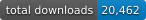

[简体中文](README.md) · **English**

# dsh-suite

> **STARDUSTLC plugin bundle for DeepSeek Harness: install 18 standalone plugins in one step with shared defaults, cohesive workbenches, and unified updates.**

Covers Office, Media, DevOps, and Notifications for DeepSeek Harness `>=0.2.2-rc.3`. Every plugin works inside the bundle or as an independent install.

[](https://www.npmjs.com/package/@stardustlc/dsh-suite) [](https://www.npmjs.com/package/@stardustlc/dsh-suite) [](https://www.npmjs.com/package/@stardustlc/dsh-suite)

**[Included Plugins](#what-is-included) · [Highlights](#highlights) · [Install](#install) · [Start Using It](#start-using-it) · [Download Stats](https://github.com/STARDUSTLC666/dsh-suite/blob/npm-downloads/README.md)**


## What is included

| Product Line | Included Plugins (independent repositories & versions) |
| :--- | :--- |
| 📨 Office | [Email](https://github.com/STARDUSTLC666/dsh-email) · [Calendar](https://github.com/STARDUSTLC666/dsh-calendar) · [RSS](https://github.com/STARDUSTLC666/dsh-rss) · [Citations](https://github.com/STARDUSTLC666/dsh-cite) · [Dream](https://github.com/STARDUSTLC666/dsh-dream) |
| 🎬 Media | [FFmpeg](https://github.com/STARDUSTLC666/dsh-ffmpeg) · [Voice](https://github.com/STARDUSTLC666/dsh-voice) · [PPT](https://github.com/STARDUSTLC666/dsh-ppt) · [HyperFrames](https://github.com/STARDUSTLC666/dsh-hyperframes) · [Remotion](https://github.com/STARDUSTLC666/dsh-remotion) |
| 🔧 DevOps | [Docker](https://github.com/STARDUSTLC666/dsh-docker) · [SQL](https://github.com/STARDUSTLC666/dsh-sql) · [Flakefinder](https://github.com/STARDUSTLC666/dsh-flakefinder) · [Code Security](https://github.com/STARDUSTLC666/dsh-code-security) · [Codex Port](https://github.com/STARDUSTLC666/dsh-codex-port) |
| 💬 Notifications & Presets | [DingTalk](https://github.com/STARDUSTLC666/dsh-dingtalk) · [Slack](https://github.com/STARDUSTLC666/dsh-slack) · [Minimal PTC](https://github.com/STARDUSTLC666/dsh-minimal-ptc) |

- **10 native main-area workbenches**: Calendar, Citations, Code Security, Dream, Email, HyperFrames, PPT, Remotion, RSS, and Voice; the remaining 8 operate via native settings and conversation tools (`dsh-sql` v0.9+ includes a native visual SQL settings panel).
- **Companion plugins (separate install)**: [@stardustlc/dsh-review](https://github.com/STARDUSTLC666/dsh-review) (Git change review) and [deepseek-computer-use](https://github.com/STARDUSTLC666/deepseek-computer-use) (Windows desktop control) are **not** bundled in these 18 components.
- Full capability and tool index: [Usage Guide · What's Inside](docs/USAGE.en.md#whats-inside-18); calendar availability suggestions: [Availability Guide](docs/calendar-availability-2026-10-30.md).

<a id="what-it-does"></a>
## Highlights

| Area | Unified Experience Across the Bundle |
| :--- | :--- |
| **10 Native Workbenches** | 9 bespoke non-reskinning UIs (Tactile Triage Deck, Airmail Letter Desk, Citation Constellation, Editorial Zine Spread, OP-SEC Instrument Deck, Director's Decks, 16:9 Slide Lightbox, Today Focus Ribbon) + Voice Studio, with one-click fallback to classic list/form views |
| **Themes & Onboarding** | 13 bright style presets, 8 bilingual font pairings, interactive `? Tour` coachmarks, host language switching, narrow-window support, and unsaved-edit protection |
| **Whale-Girl Icon Set** | Since 0.9.1, the bundle and all 18 plugins ship purpose-made icons with distinct function emblems and transparent padding for native DSH list/detail views |
| **Pinned & Hot-Reload Safe** | Pins tested component versions, adds bilingual metadata, and cleans up resources via Cordis `ctx.effect` for reproducible co-loading |
| **On-Demand Delivery Packs** | The PPT workbench exports either a ready-to-share bundle (with speaker notes) or a full project package (with JSON) directly—no AI pre-review required to download |

## Install

In DSH Desktop, install `@stardustlc/dsh-suite` from the **Plugins** panel, or use the bundled CLI:

```bash
dsh plugin --profile desktop add @stardustlc/dsh-suite
```

For the web profile, replace `desktop` with `web`. Restart DSH after installation. Requires official DSH **`>=0.2.2-rc.3`**.

## Start using it

1. Install `@stardustlc/dsh-suite` in your `desktop` or `web` profile, then restart that profile.
2. Verify in plugin management that Suite and its 18 components loaded (install Review and Computer Use separately if needed).
3. Configure only the plugins you plan to use: email and calendar need account credentials; media plugins need their local runtimes.
4. Launch a task from a sidebar workbench or chat tools and verify the actual output.
5. Check updates from the footer of any component page; Suite updates as a single bundle and hot-reloads in place when supported.

## Requirements and configuration

- **Per-plugin prerequisites still apply**: enable only the Suite layer in your profile, while keeping each component's own account, executable (e.g. FFmpeg, Docker), and network setup.
- **DSH host version**: requires official DSH `0.2.2-rc.3` or newer. Older hosts still load components, but the footer update control will not appear until DSH is upgraded.
- **Avoid duplicate installs**: components can be installed independently, but **do not install the same plugin both standalone and via Suite**—this triggers `duplicate loader entry id`. See [Migration Steps](docs/USAGE.en.md#migrate-an-older-suite-installation).
- **Compatibility guard**: if a release requires a newer DSH or Node.js version, the footer explains why and keeps the current version running. For source development, see [package.json](package.json).
- **Validation references**: `0.2.2-rc.3` adaptation checks (loading, contracts, offline tests) are recorded in [rc3 validation](docs/validation-2026-11-14-rc3.md); see [Workbench UI Guide](docs/WORKBENCH_UI.md) and [2026-10-28 boundaries](docs/validation-2026-10-28-boundaries.md) for UI design and operational boundaries.

## Plugin updates

- **Inline footer controls**: located at the bottom of each workbench (or native plugin details for non-workbench plugins) with inline checks, release notes, and preferences; acting on any component updates the entire Suite.
- **Safe defaults**: automatic checks run at most every 6 hours, while **automatic installation is off by default**. Explicit opt-in installs compatible minor/patch releases only when idle with no unsaved edits.
- **In-place hot reload**: updates run directly from the inline footer controls with automatic rollback on load failure and no forced DSH restarts; local-source installs stay untouched.
- **Upgrading older installs**: older Suite releases require one manual update in native plugin management to gain these controls.

## Documentation & Feedback

- [Usage & troubleshooting](docs/USAGE.en.md) · [Workbench UI](docs/WORKBENCH_UI.md) · [Changelog](CHANGELOG.md) · [Validation history](docs/VALIDATION.md)
- Report bugs in [Issues](https://github.com/STARDUSTLC666/dsh-suite/issues).

## License

[MIT](LICENSE)
