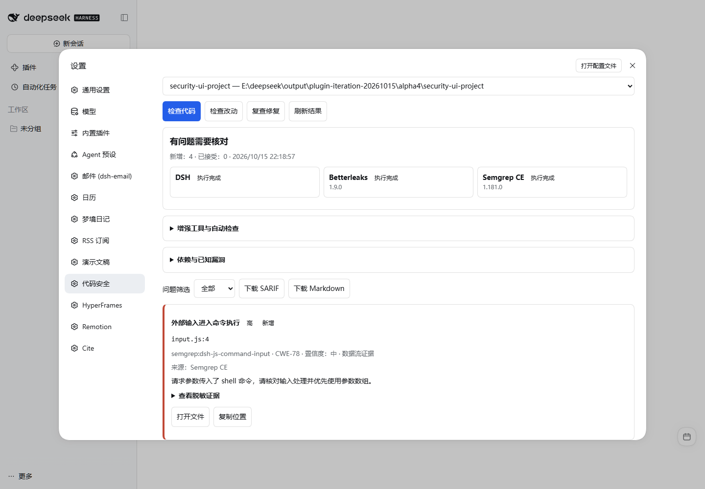
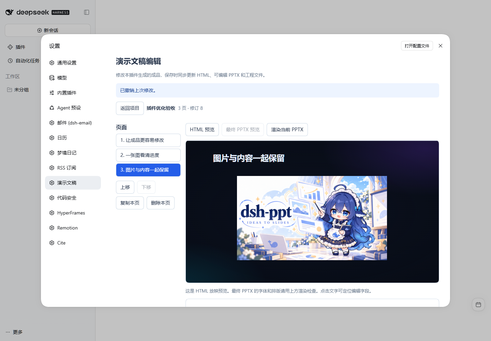

# DSH 0.2.1-alpha.4 兼容性验收

2026-10-15，Windows、Node 24.16.0。使用官方 npm `@deepseek-ai/dsh@0.2.1-alpha.4`；对应[源码标签](https://github.com/deepseek-ai/deepseek-harness/releases/tag/dsh-v0.2.1-alpha.4)提交为 `86a402200d95fecef4529d969836f1fe13c6cb0d`。这是 alpha 预览频道，当日 npm `latest` / `next` 仍为 `0.2.0-rc.2`。

## 更新影响

官方现在优先读取插件自己的 `engines.dsh`，没有该字段时继续检查 DSH peer 依赖；兼容性拒绝记录的字段由 `peers` 改为 `requirements`。本套件与 18 个组件均没有冲突的 DSH 版本声明，也没有读取旧拒绝字段的业务代码，因此本轮没有修改组件实现或提高最低宿主版本。

源码差异还包含自定义插件索引、Office 交付指引及网页与宿主版本变更提示。没有发现它们要求当前组件改用其他接口的证据。官方[迁移指南](https://github.com/deepseek-ai/deepseek-harness/blob/dsh-v0.2.1-alpha.4/docs/upgrade-guide/v0.2.1-alpha.3/plugin-engines-dsh/guide.zh.md)说明了声明范围和拒绝字段的具体变化。

## 验证结果

| 层次 | 结果与范围 |
| --- | --- |
| 官方兼容性预检 | alpha.3 / alpha.4 各检查全部 19 个包，均通过；使用官方 `evaluatePluginCompatibility`，不配置版本豁免。 |
| 拒绝回归 | 分别为一个组件、组合包注入不兼容的 `engines.dsh`；均在导入组件代码前失败，不进入后续契约检查。 |
| 契约 | 18 个组件通过工具/技能注册、16 项健康结果、19 项输出和 2 项注册丢失恢复检查；不调用真实账号服务。 |
| 公开安装 | 官方 CLI 从公开 npm 安装 Suite 0.2.25 及全部 18 个传递组件，逐一核对版本和锁文件完整性摘要；未用本地组件覆盖。 |
| 真实宿主 | 18 插件、111 工具、36 技能；极简 PTC 预设能挂载，模型入口为 `run_code`，调度工具保持可用；鉴权 303/401/200 与正常退出通过。 |
| 安全工作台 | 14 项浏览器交互、0 个页面/控制台错误；三种原生引擎、空态、取消、复查、脱敏、SARIF 下载、中英文和 390px 布局通过。 |
| 自动安全检查 | 在真实 DSH Agent 中重放任务开始/结束事件，产生独立自动检查状态，并被动加入脱敏上下文；未调用模型。 |
| PPT 工作台 | 21 项浏览器断言、0 个页面/控制台错误；复制、删除、撤销、最后一页保护、未保存输入保护、中英文和 390px 操作通过。 |
| 套件测试 | 12 项通过，0 项跳过。 |

实际浏览器操作使用公开安装的隔离 Web profile。先按用户路径完成预览说明并关闭账号引导，再从“账号菜单 → 设置”进入工作台；修正了旧验收脚本过早按快捷键的问题。没有填写用户的密钥或连接个人账号。





## 后续兼容性检查

`verify-local.mjs` 和 `verify:compat` 现在在组件契约执行前调用目标宿主的官方兼容检查，同时覆盖组件与套件本身。失败时保留官方拒绝原因；旧宿主未提供该接口时明确记录为跳过，后续契约与真实启动检查仍须分别查看。

```bash
node scripts/verify-local.mjs --harness-root <built-harness> --workspace-root <plugin-parent> --contracts-only --report <report.json>
```

## PR / Issues 和边界

当日自有插件仓库没有开放 PR，仍有三条历史反馈：RSS #2 的 Linux 连接错误、HyperFrames #2 的市场安装器启动路径错误、Email #19 的收件人策略咨询。RSS 0.6.2 已包含连接错误隔离修复；这次没有把 Windows 未自然复现写成原 Linux 场景已复现。HyperFrames 在本次官方 CLI 安装中正常，不据此宣称第三方市场启动器已修复。Email 的相关规则已实现，需按具体使用反馈继续核对。

本轮没有操作原生桌面窗口，没有调用真实模型，没有重测全部账号服务，也没有把两个工作台的浏览器验收算作每个插件的完整业务验收。OSV 离线操作使用合成漏洞库，验证工具接线与界面结果，不代表完整公共漏洞库审计。活动聊天中的安全文件跳转未重测。

This check covers the official alpha.4 CLI/runtime, all 19 package compatibility manifests, a clean public installation, joint loading, and Security/PPT browser interactions. Native Desktop, live model turns and all external account services remain outside this run.
